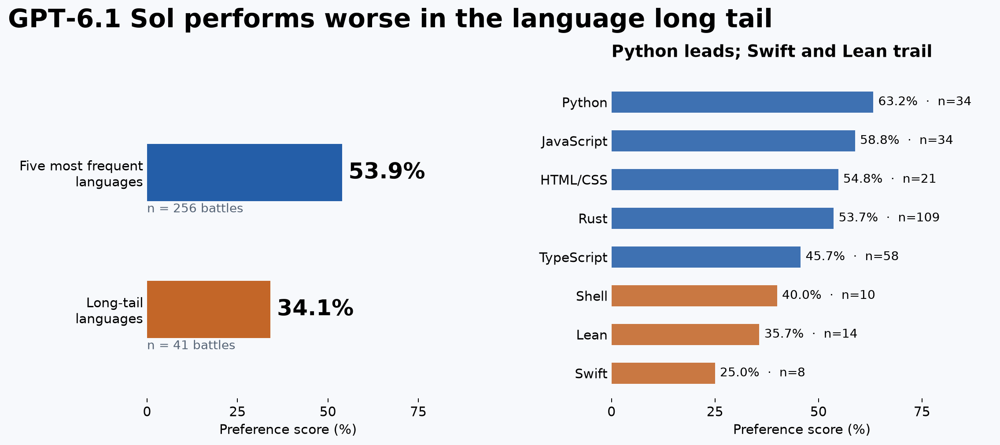

+++
title = "GPT 6.1 Sol seems to do worse on long-tail languages."
date = "2026-11-13T16:41:09-06:00"
slug = "gpt-6.1-sol-long-tail-languages"
draft = false
showFooter = true
description = "Jev language tags across 712 Sol battles suggest weaker results outside the five languages that dominate our dataset."
+++

[srcreigh](https://news.ycombinator.com/user?id=srcreigh) wrote in a [Hacker News comment](https://news.ycombinator.com/item?id=50489509):

> The ideal language is the one the agent knows how to use.
>
> I used prolog for a project and GPT 6.1 Sol repeatedly made dumb mistakes as if it doesn’t understand the symbolic resolution capabilities.

That made me curious: does Sol do worse when it's working outside the usual programming languages?

We have some data to look at! We're working on a [battle system for OpenCode](https://github.com/bottomless/agent-duel), which lets users compare models on their actual tasks. I used [Jev](https://openrouter.ai/docs/guides/community/jev) to tag the programming languages in all 712 Sol battles, using the requests and available conversation context without showing it the outcomes.

Of those battles, 617 had a vote, including early votes. We could identify a primary language in 297 of the scored battles.

The comparison here is 138/256 for common languages vs 14/41 for uncommon ones, counting ties as half a win. The opponent-adjusted regression test (with user-clustered standard errors) on the difference here results in a p-val of 0.0028, which is pretty confident!
