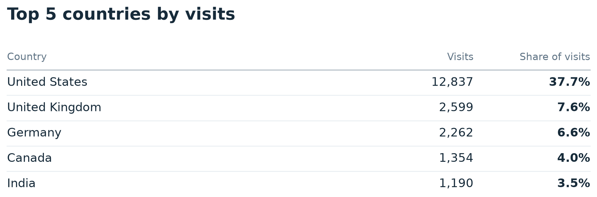
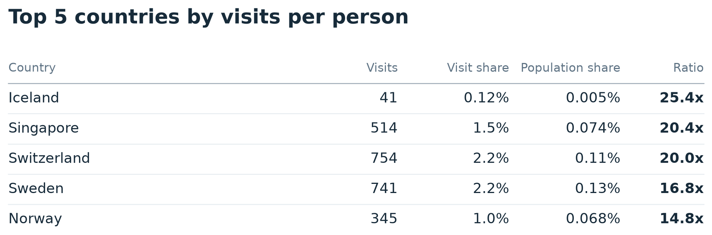

+++
title = "Science, startups and beer drinking predict 92% of a country's HN readership"
date = "2026-11-27T00:00:00-06:00"
slug = "hn-readership-science-startups-beer"
draft = false
showFooter = true
description = ""
+++

In yesterday's ["happy thanksgiving" thread](https://news.ycombinator.com/item?id=50655664) on HN there was a clear split between people who were obviously American / Canadian and the rest of the world. (Example: [this "what is thanksgiving?" comment](https://news.ycombinator.com/item?id=50656011).) This got me wondering about HN's audience, by location.

Luckily, this blog received ~34k hits from Hacker News over the last 7 days, so I have a super recent sample to draw from. (With the obvious caveat that the following only applies to people who click on two articles about AI models and one about Lean. Also, the data source here is IP matching; the analytics for this blog are extremely simple, by design.)

The first thing I did was pull up a chart of readers by country. Here are the top 5 countries and the top 5 countries in proportion to their population. 

Indeed, 41.7% of HN visits are from countries that celebrate Thanksgiving. 

## Predicting HN country readership

Next, I thought I'd have some fun and see what predicts HN readership. To start, I came up with a list of things that I thought could be related, and graphed them.

[![Grid of 16 scatter plots, one per country trait, each against share of visits divided by share of world population for 50 countries, sorted by R squared on its own: NordVPN servers per person 0.87, scientific papers per person 0.84, GDP per capita 0.82, home broadband 0.60, YC startups per person 0.47, English speakers 0.47, working hours 0.46 (negative), population 0.45 (negative), happiness 0.43, social media time 0.43 (negative), median age 0.30, VPN app downloads 0.26, all alcohol 0.23, beer drinking 0.19, freelancers 0.01, obesity 0.00](sixteen-traits-vs-visits.png)](sixteen-traits-vs-visits.svg)

Next, I threw them into a regression, and started filtering out less significant variables. (A method I learned in an econometrics class.) Eventually I whittled it down to only three variables, and the best three variable fit was scientific papers published per million people, YC startups per million people (based on [Y Combinator's company directory](https://www.ycombinator.com/companies)), and beer drinking (according to the [World Health Organization](https://ourworldindata.org/grapher/beer-consumption-per-person))!

(note: I had to drop a lot of countries here that didn't have overlapping data, so this analysis is based on 50 countries)

This model worked extremely well! Here's a chart of what scientific papers, YC startups and beer predict, against the actual readership:

## Why beer drinking

This is curious! Why did this help the model a lot, when in fact beer was one of the worst variables in terms of R squared? To investigate this, I charted the countries against the model without the beer drinking variable, and made point size represent amount of beer drinking.

The graph shows that "Beer" is essentially a stand-in for Central and Eastern Europe, who apparently visit HN at a higher rate than their YC startup and science numbers would suggest.
