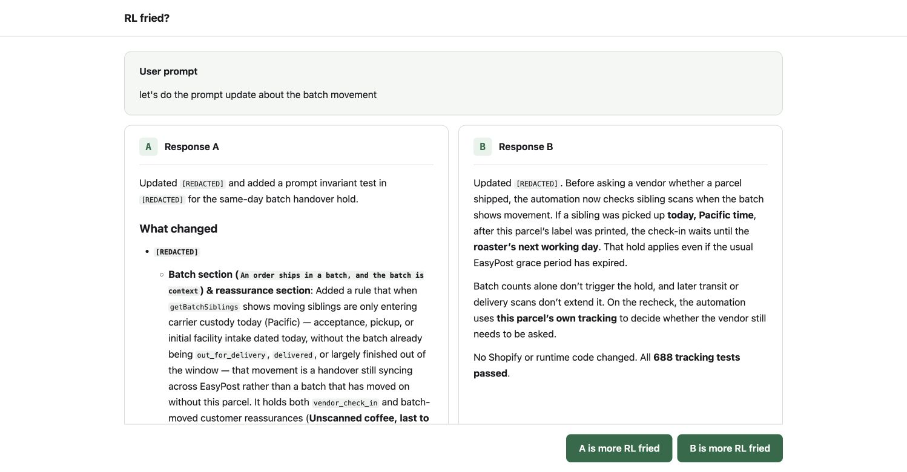
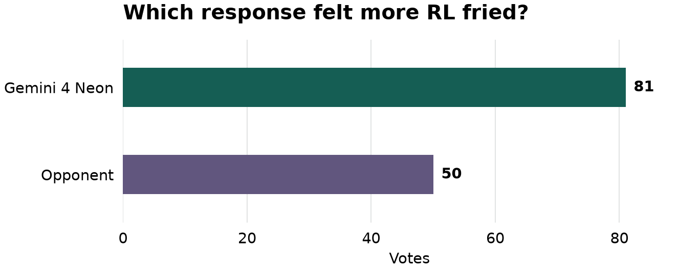
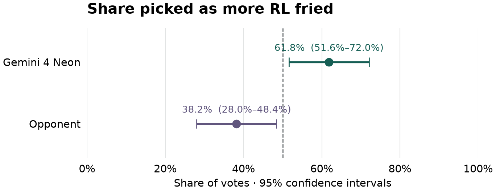

+++
title = 'Neon is not less "RL fried" than opponents'
date = "2026-11-28T00:24:10-06:00"
slug = "neon-rl-fried"
draft = false
showFooter = true
+++

A [hacker news comment](https://news.ycombinator.com/item?id=50673840) today claimed that Gemini 4 Neon "[h]as none of the RL fried optimized-for-coding feeling". This piqued my interest as a possible solution to a puzzle I've had on my mind. People seem to love Neon, yet it's doing just okay on [our leaderboard](https://agentduel.com/leaderboard).

Could the "feels less RL fried" claim explain the love for Neon?

To test this, I pulled all 85 of Neon's battles against Opus 5.5 and Astra 6.2 in our snapshot. I screened the complete transcripts with Jev, redacted details like PR numbers, commit hashes, and filenames, and ran the redacted text through Jev again. That left 39 battles for the test.

I then built a quick [side-by-side comparison app](https://rl-fried.vercel.app/) where voters don't see the model identities until after the vote. Here's what it looks like:

About 88 minutes after the first vote, the app had received **131 votes from 53 unique browser IDs**. Voters picked Neon as *more* RL fried 81 times and its opponent 50 times.

Here's the vote share with 95% confidence intervals. The dashed line is a 50/50 split.

The one-sided p-value for Neon being picked more than half the time is **0.012**.
