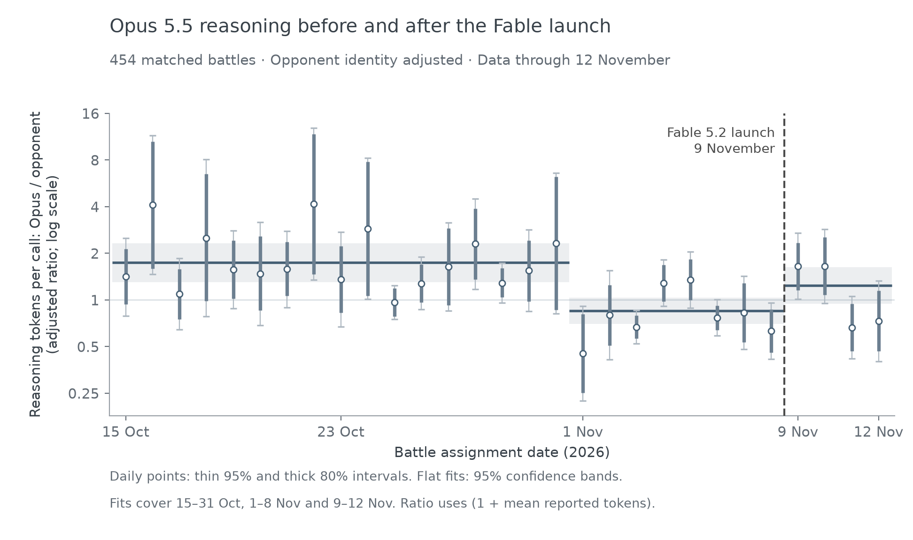

+++
title = "Opus 5.5 is probably still nerfed"
date = "2026-11-13T12:00:00-06:00"
slug = "opus-5.5-after-fable"
draft = false
showFooter = true
description = "Checking Opus 5.5's reasoning output again after the Fable 5.2 launch."
+++

A few days ago, [I wrote about Opus 5.5 being nerfed](/blog/get-ready-for-fewer-opus-5.5-em-dashes/). One theory was that this was because of testing Fable 5.2, so I wanted to check again, since [Fable has now launched](https://www.anthropic.com/claude-fable-and-mythos-5-2).

Here's a chart of Opus 5.5's reported reasoning tokens per request, relative to alternative models in the same battles. The vertical line is the Fable release date, November 9:

From our data alone, we can only say that it’s likely that Opus is still nerfed. The p-val on the bootstrap test of before and after the Fable launch is p=0.105.
