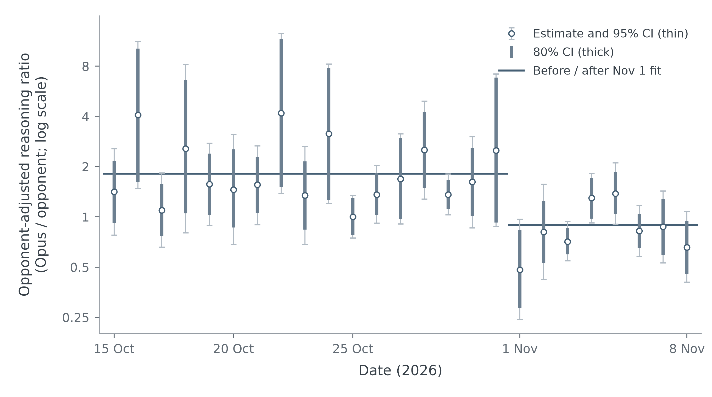
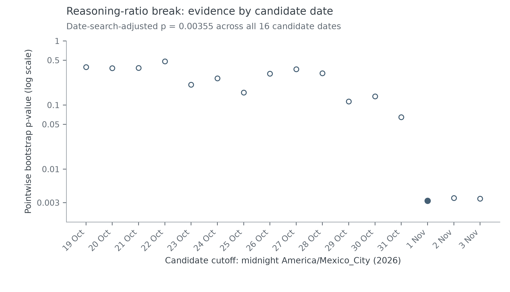
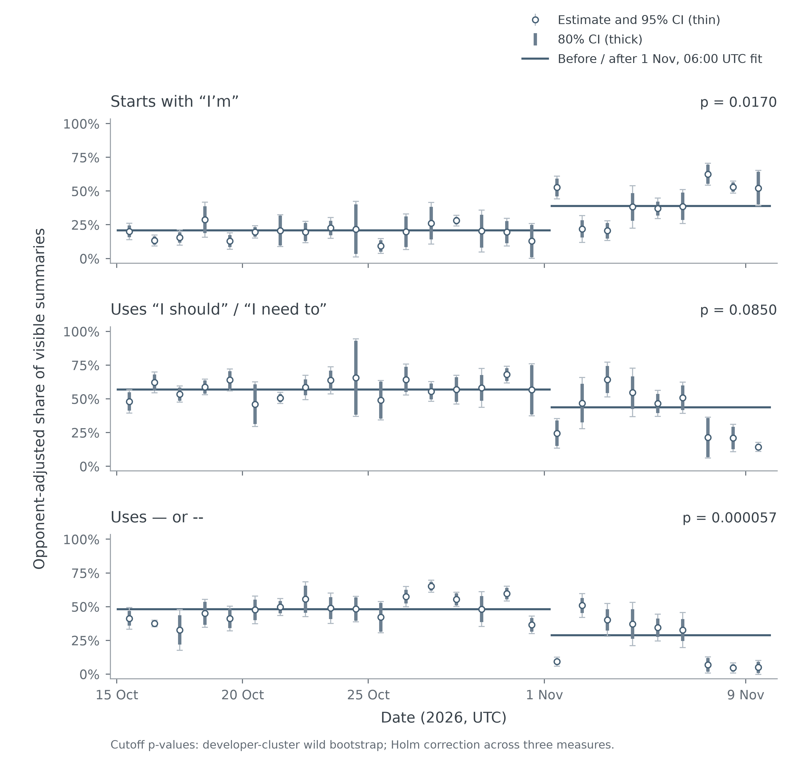

+++
title = "Get ready for fewer Opus 5.5 em-dashes"
date = "2026-11-10T10:30:46-06:00"
draft = false
showFooter = true
description = "Opus 5.5's reasoning output shifted relative to matched opponents, and its visible thinking summaries started using fewer em dashes."
+++

A few days ago, a popular [Hacker News post](https://news.ycombinator.com/item?id=50422069) argued that Opus 5.5 had been nerfed, showing that reasoning tokens declined and language use changed.

In the thread, someone asked if anyone had proof of this, and I realised we did! We are working on a [battle system for OpenCode](https://github.com/bottomless/agent-duel), which gives us [data](https://agentduel.com/leaderboard) of how Opus 5.5 behaves in comparison to opponents.

## Confirming the post

First, we checked if the post is confirmed by our data, and it is! Opus’s reasoning output fell 50.6% relative to matched opponents!

## Confirming the date

The post claims Opus was nerfed on Nov. 3, but looking at a chart of our data, this did not seem to be the case. In fact, Nov. 1 looked more likely. 

To investigate this timing, we tested 16 candidates dates with a bootstrap breakpoint test. Nov. 1 produced the strongest reasoning-ratio break, although Nov. 2 and Nov. 3 could easily be the break date, too.

| Candidate cutoff | Relative change | p-value |
|---|---:|---:|
| October 29 | −36.4% | 0.11351 |
| October 30 | −36.4% | 0.13598 |
| October 31 | −40.5% | 0.06444 |
| **November 1** | **−50.6%** | **0.00320** |
| November 2 | −47.3% | 0.00353 |
| November 3 | −45.2% | 0.00347 |

## Looking at language changes

The post also claims language changes in early november, so we looked into this too. 

All three measures moved in the reported direction: more “I’m,” less “I should” or “I need to,” and fewer dashes. Two passed correction for multiple testing.

| Wording feature | Before → after | Adjusted p-value |
|---|---:|---:|
| Starts with “I’m” | 20.8% → 38.9% | 0.0170 |
| Uses “I should” / “I need to” | 57.0% → 43.8% | 0.0850 |
| Contains em dash or `--` | 48.0% → 28.9% | 0.0000572 |

## Further investigations -- the em-dashes

I was curious if these words changed, what else might have changed, and I found something interesting! Opus’s adjusted em-dash frequency fell about 43%, while its opponents’ barely changed.

To find candidate words, we ranked words, punctuation, and whitespace by their overall frequency across both periods, then ran a statistical test. (To be honest, I was worried this was a fishing expedition so a normal p-val wouldn't work and Astra suggested a BH-25 p-val).

Five patterns had adjusted p-values below 0.05:

| Pattern     | Opus before → after | Opponents before → after | Adjusted p-value |
|---|---:|---:|---:|
| in | 77.18 → 99.89 | 77.49 → 79.84 | 0.0207 |
| I’m | 90.58 → 155.07 | 46.96 → 54.25 | 0.0324 |
| **Em dash —** | **14.76 → 8.40** | **7.01 → 6.76** | **0.0440** |
| Hyphen - | 37.14 → 31.51 | 42.48 → 45.94 | 0.0440 |
| the | 611.87 → 780.69 | 528.20 → 526.03 | 0.0462 |

## Speculation

Since em-dashes are a major complaint about Opus, it seems this goes beyond nerfing and is actually a new model being tested. 

The increase in "I'm" is also interesting. Any system has a set of affordances that help a user interact with it, and to some extend personhood is the affordance of an AI agent. It seems Opus is going to lean even harder in this direction.

